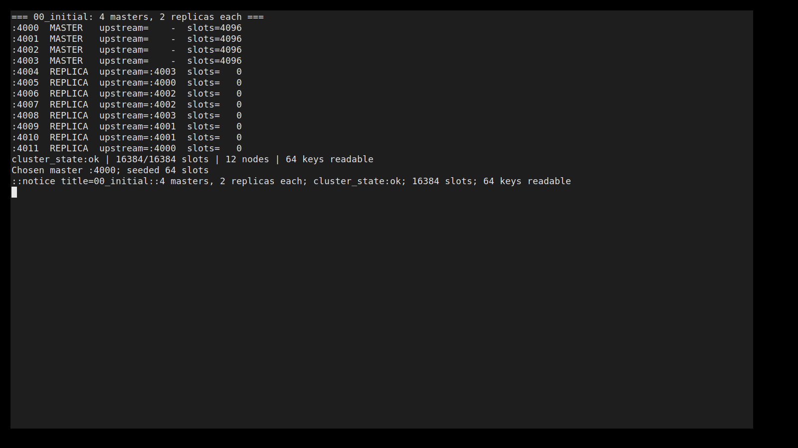
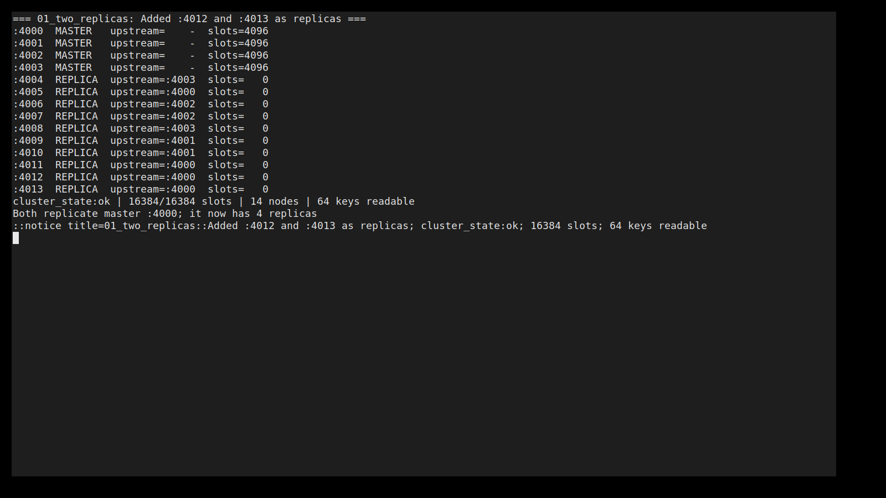
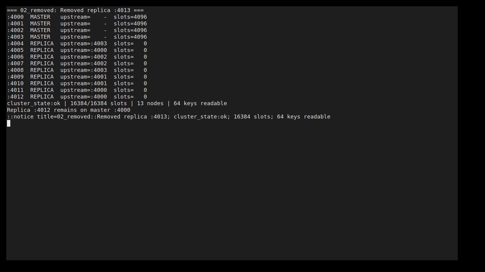
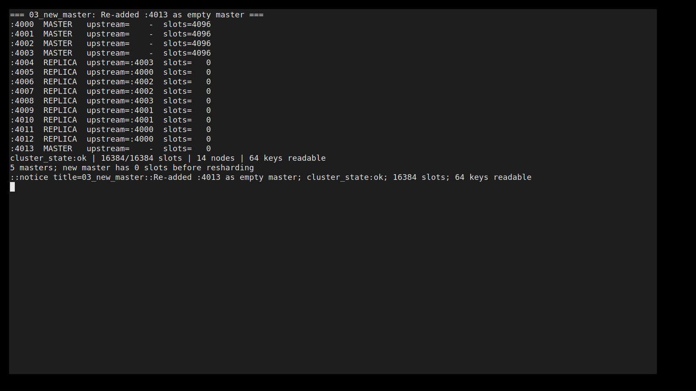
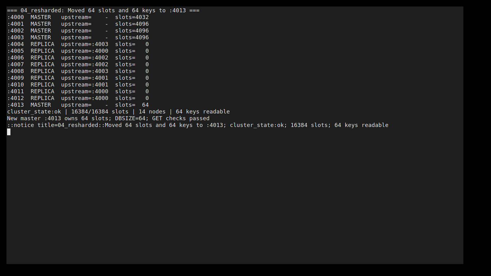

# Масштабирование Redis Cluster

Задание выполнено для **варианта 2, порты 4000–4013**. Сценарий создаёт временный кластер с четырьмя мастерами и двумя репликами на каждого, затем добавляет две реплики одному выбранному мастеру, удаляет одну из них и заново добавляет тот же порт как мастер. После этого 64 слота вместе с 64 проверочными ключами переносятся на новый мастер.

## Этапы

| Этап | Состояние кластера | Проверка |
| --- | --- | --- |
| 0 | 12 узлов: 4 мастера, 8 реплик | `cluster_state:ok`, 16 384 слота, чтение 64 ключей |
| 1 | Порты 4012 и 4013 добавлены репликами одного мастера; 14 узлов | У выбранного мастера 4 реплики, все ключи читаются |
| 2 | Реплика 4013 удалена; 13 узлов | Остались 4 мастера и 9 реплик, кластер работоспособен |
| 3 | Порт 4013 добавлен снова как мастер с новым ID; 14 узлов | 5 мастеров, новый мастер пока без слотов |
| 4 | 64 слота и 64 ключа перенесены на мастер 4013 | `DBSIZE=64`, все 16 384 слота покрыты, значения читаются |

На каждом этапе выполняются `CLUSTER INFO`, `redis-cli --cluster check`, проверка числа узлов и ролей, а также чтение всех проверочных ключей. Скриншоты сняты с терминала GitHub Actions во время каждого этапа.

## Результат

[Успешный запуск GitHub Actions](https://github.com/breevasofa/23---11/actions/runs/45678136136) · [Word-отчёт](Отчёт_масштабирование_Redis_Cluster.docx)











**Вывод:** после добавления и удаления реплик кластер сохранил покрытие всех 16 384 слотов и доступность проверочных ключей. Новый мастер сначала не владел слотами; после решардирования получил 64 слота и 64 ключа. Во всех пяти состояниях `cluster_state:ok`.

## Запуск

На Linux с установленными `redis-server` и `redis-cli`:

```bash
python3 Redis_Cluster_Expansion/expand_cluster.py
```

Для повторного захвата снимков нужны `Xvfb`, `xterm` и `scrot`:

```bash
bash Redis_Cluster_Expansion/capture_terminal.sh
```

Данные и конфигурации узлов создаются во временном каталоге и удаляются после завершения сценария. Проверка на GitHub запускается [workflow](../.github/workflows/redis_cluster_expansion.yml).

Операции добавления, удаления и решардирования используют штатные команды из [документации Redis Cluster](https://redis.io/docs/latest/operate/oss_and_stack/management/scaling/).
